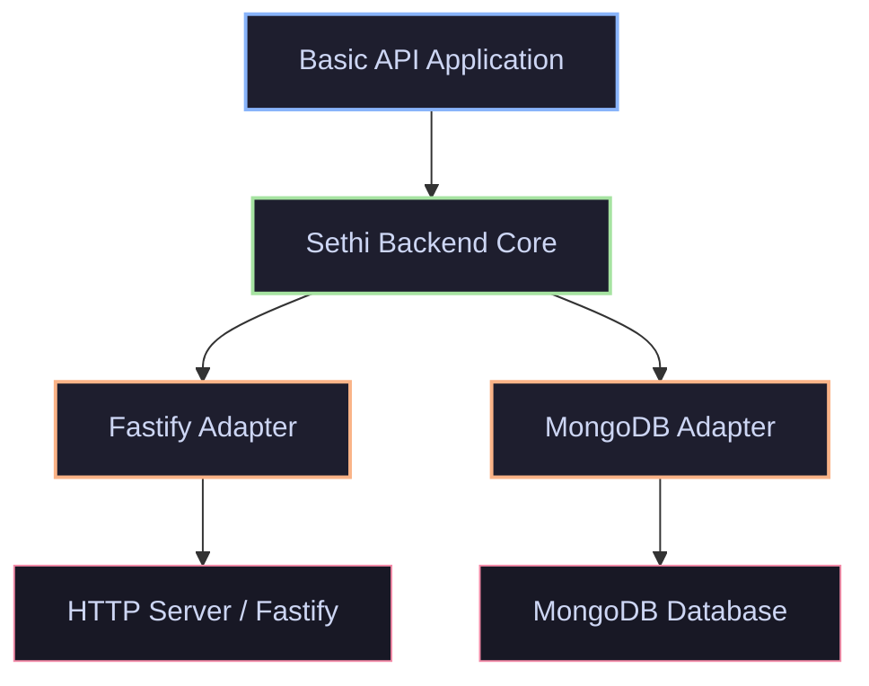
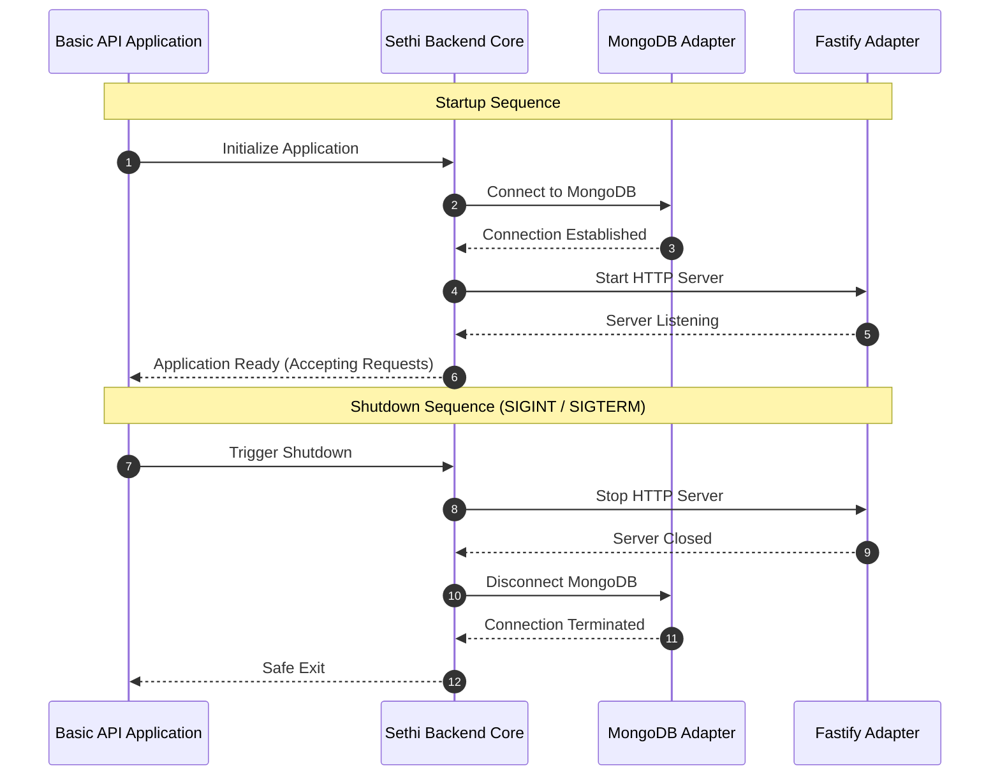

<div align="center">

# Sethi Backend

  <p><strong>An evolving modular TypeScript backend framework built with independent infrastructure adapters.</strong></p>
  <p>Separating the application lifecycle from HTTP servers and database implementations.</p>

  <p>
    <a href="https://github.com/usman-sethi/sethi_backend"></a>
    <a href="https://github.com/usman-sethi/sethi_backend"></a>
    <a href="https://github.com/usman-sethi/sethi_backend"></a>
    <a href="https://github.com/usman-sethi/sethi_backend"></a>
    <a href="https://github.com/usman-sethi/sethi_backend"></a>
    <a href="https://github.com/usman-sethi/sethi_backend"></a>
  </p>

  <p>
    <a href="#-about-sethi-backend">About</a> &bull;
    <a href="#-current-development-status">Status</a> &bull;
    <a href="#-architecture">Architecture</a> &bull;
    <a href="#-getting-started">Getting Started</a> &bull;
    <a href="#-api-endpoints">API Endpoints</a> &bull;
    <a href="#-testing">Testing</a> &bull;
    <a href="#-roadmap">Roadmap</a>
  </p>

</div>

---

## About Sethi Backend

**Sethi Backend** is a modular TypeScript backend framework engineered to provide a clean, decoupled foundation for building backend applications. By strictly separating the application lifecycle from infrastructure concerns—such as HTTP server frameworks and database drivers—Sethi Backend prevents tight coupling and ensures high testability, maintainability, and architectural longevity.

### Why Sethi Backend?
* **Decoupled Architecture:** Business logic and lifecycle management are completely independent of specific web frameworks (like Fastify) or persistence layers (like MongoDB).
* **Adapter Pattern:** Infrastructure is plugged in through rigorous TypeScript contracts (`@sethi-backend/*`), allowing components to be swapped or mocked effortlessly.
* **Monorepo Agility:** Built with `pnpm workspaces`, enabling clean separation of concerns across core modules, adapters, and example applications.
* **Robust Lifecycle Management:** Unified startup, liveness, readiness, and graceful shutdown sequencing out of the box.

---

## Current Development Status

Sethi Backend is currently in active development. The foundational milestone is complete, featuring a fully integrated basic API example.

| Category | Status | Capabilities |
| :--- | :--- | :--- |
| **Monorepo & Core** | ✅ Implemented | pnpm workspace setup, core engine lifecycle, HTTP/database adapter contracts, automated tests. |
| **HTTP Layer** | ✅ Implemented | Fastify server adapter, request/response lifecycle integration. |
| **Database Layer** | ✅ Implemented | MongoDB adapter, connection management, readiness probes (`/ready`). |
| **Observability** | ✅ Implemented | `/health` liveness endpoint, `/ready` database check, structured graceful shutdown. |
| **Security & Auth** | ✅ Implemented | Environment validation, Argon2id password hashing, JWT access tokens, persistent MongoDB sessions with refresh-token rotation/revocation, HttpOnly refresh cookies, CSRF protection, strict CORS and route-level rate limits. |
| **Developer Tooling** | 🚧 Planned | CLI code generators, project scaffolding, advanced documentation & release automation. |

---

## Technology Stack

The framework leverages modern, high-performance tooling built for type safety and developer velocity:

* **Language:** TypeScript (^5.x)
* **Package Manager:** pnpm Workspaces
* **HTTP Framework:** Fastify
* **Database Driver:** MongoDB Node.js Driver
* **Testing Framework:** Vitest
* **Runtime:** Node.js (>=20.0.0)

---

## Architecture

Sethi Backend organizes code into decoupled workspace packages under `packages/` and functional examples under `examples/`.

```text
sethi_backend/
│
├── packages/
│   ├── core/                  # Application lifecycle and adapter contracts
│   ├── adapter-fastify/       # Fastify HTTP server implementation
│   └── database-mongodb/      # MongoDB connection and client manager
│
├── examples/
│   └── basic-api/             # Integrated sample application
│
├── .env.example
├── pnpm-workspace.yaml
├── tsconfig.base.json
└── package.json
```

### Package Responsibilities
* **`@sethi-backend/core`**: Defines abstract contracts for servers and databases, managing the overarching application startup and shutdown lifecycle.
* **`@sethi-backend/adapter-fastify`**: Implements the server contract using Fastify, translating HTTP requests and routing lifecycle hooks.
* **`@sethi-backend/database-mongodb`**: Implements the database contract, handling MongoDB connections, client pooling, and health pinging.
* **`@sethi-backend/example-basic-api`**: Demonstrates how to wire core services, Fastify, and MongoDB together into a runnable backend application.

### Dependency Flow Diagram



---

## Lifecycle Sequence

The startup and graceful shutdown sequences guarantee predictable initialization and resource release across infrastructure components.



---

## Getting Started

### Prerequisites
* **Node.js**: `>=20.0.0`
* **pnpm**: `>=8.0.0`
* **MongoDB**: Local installation running on `mongodb://127.0.0.1:27017` or a reachable MongoDB Atlas instance.

### 1. Clone the Repository
```bash
git clone https://github.com/usman-sethi/sethi_backend.git
cd sethi_backend
```

### 2. Install Dependencies
```bash
pnpm install
```

### 3. Configure Environment Variables
Copy the example environment configuration file:

* **PowerShell (Windows):**
  ```powershell
  Copy-Item .env.example .env
  ```
* **Bash (Linux/macOS):**
  ```bash
  cp .env.example .env
  ```

Ensure your `.env` file is configured correctly:
```env
HOST=127.0.0.1
PORT=3000
MONGODB_URI=mongodb://127.0.0.1:27017
MONGODB_DATABASE=sethi_backend_dev
JWT_SECRET=<unique random secret of at least 32 bytes>
```

Generate a secret rather than using the placeholder:

* **PowerShell:** `[Convert]::ToBase64String([Security.Cryptography.RandomNumberGenerator]::GetBytes(48))`
* **OpenSSL:** `openssl rand -base64 48`

> **Note:** Ensure your MongoDB instance is active and reachable before starting the application. Never use the example placeholder in production or commit real database credentials or production secrets.

---

## Building the Project

Compile all workspace packages in dependency order:
```bash
pnpm build
```

To build individual workspace packages separately:
```bash
pnpm --filter @sethi-backend/core build
pnpm --filter @sethi-backend/adapter-fastify build
pnpm --filter @sethi-backend/database-mongodb build
pnpm --filter @sethi-backend/example-basic-api build
```

---

## Running the Example Application

Start the integrated basic API example in development mode:
```bash
pnpm --filter @sethi-backend/example-basic-api start
```

The server will initialize at:
`http://127.0.0.1:3000`

---

## API Endpoints

The basic API example exposes health, readiness, CSRF-token, and authentication
endpoints:

| Method | Endpoint | Purpose |
| :--- | :--- | :--- |
| `GET` | `/health` | Application liveness check |
| `GET` | `/ready` | MongoDB database readiness check |
| `GET` | `/csrf-token` | Creates a CSRF token for a cookie-authenticated client |
| `POST` | `/auth/register` | Register, create a persistent session, and return an access token |
| `POST` | `/auth/login` | Authenticate and create a separate device session |
| `POST` | `/auth/refresh` | Rotate the refresh token and issue a new access token |
| `POST` | `/auth/logout` | Revoke the current refresh-token session |
| `POST` | `/auth/logout-all` | Revoke every active session for the authenticated user |
| `GET` | `/auth/me` | Return the authenticated user's public profile |

Authentication POST requests require a CSRF token and cookie. Fetch
`GET /csrf-token`, retain its cookie, and send the returned value in
`X-CSRF-Token`. Registration and login return the access token and public user
in JSON; refresh tokens are sent only as HttpOnly, SameSite=Lax cookies scoped
to `/auth`. Access tokens are bound to persistent sessions, and a revoked or
expired session invalidates its access tokens. Refresh tokens rotate on every
refresh, and session records persist only their SHA-256 hashes. The default
session lifetime is 30 days; MongoDB TTL cleanup is asynchronous.
If registration succeeds in creating a user but session creation fails, that
user record remains and can sign in later.

Each successful refresh atomically swaps the current token hash and appends the
consumed hash to its session document. Reuse of any consumed token is treated as
replay and revokes that session; this strict policy also applies to simultaneous
refresh attempts, so one attempt may receive a response whose access token is
immediately invalidated by the competing replay. Consumed hashes remain only
until the session expires and MongoDB TTL cleanup removes its document.
Sessions are revoked at 100,000 rotations rather than allowing their retained
history to grow without bound; the user must authenticate again. Rotation uses
single-document atomic updates and does not require MongoDB transactions or a
replica set. Session documents have a unique current-token index, a consumed
hash lookup index, an expiry TTL index, and a user/revocation index.
On the first startup after this replay-history change, legacy active sessions
without consumed-token history are revoked; affected users must sign in again.

Refresh, logout and logout-all security events are logged with event type and
safe user/session identifiers only. The refresh route is limited to 10
requests per minute per rate-limit key.

Use the access token as a bearer token for `/auth/me` and `/auth/logout-all`.
The logout-all endpoint also requires a CSRF token because browser clients may
send the refresh cookie.

### Response Examples

* **`/health` (Liveness)**
  ```json
  {
    "status": "ok",
    "service": "sethi-backend",
    "uptimeSeconds": 12
  }
  ```

* **`/ready` (Readiness)**
  ```json
  {
    "status": "ready",
    "database": "reachable"
  }
  ```
  > *Note: `/ready` returns HTTP status `503 Service Unavailable` if the MongoDB database connection is dropped or unreachable.*

## Fastify HTTP security

The Fastify adapter exposes `registerHttpSecurity`. Register it before routes,
with an explicit origin allowlist and the application environment:

```ts
registerHttpSecurity(http.instance, {
  allowedOrigins: ["https://frontend.example"],
  environment: "production",
});
```

The adapter adds Helmet headers, credentialed CORS for only the configured
origins, cookie parsing/serialization, CSRF-token helpers, and a rate-limit
plugin that is opt-in per route. CORS origins are normalized and reject
wildcards, `null`, invalid URLs, and non-HTTPS production origins. A disallowed
browser origin may still receive an HTTP response, but it does not receive
`Access-Control-Allow-Origin`.

CSRF verification is also opt-in per route, so public and bearer-token routes
are not forced to use CSRF tokens. Use `createCsrfProtectionHook` on routes
that rely on browser cookies, and obtain a token from `GET /csrf-token` before
sending the `X-CSRF-Token` header:

```ts
http.instance.post(
  "/account/update",
  {
    onRequest: createCsrfProtectionHook(http.instance),
    config: { rateLimit: { max: 10, timeWindow: "1 minute" } },
  },
  async () => ({ status: "updated" }),
);
```

CSRF cookies are HttpOnly, SameSite=Lax, and Secure in production. The default
rate-limit store is in-memory; multi-instance deployments need a shared store.
Configure Fastify's proxy trust only for known trusted reverse proxies before
relying on forwarded client addresses or HTTPS termination.

---

## Testing

Run the test suite across all workspace packages via Vitest:
```bash
pnpm test
```

### Test coverage
The Vitest suite covers core lifecycle behavior, HTTP security and CORS, config
validation, password/token utilities, authentication routes, session behavior,
and mocked MongoDB repository operations.

The authentication repository tests use mocks; they do not claim a live
MongoDB integration test. The Fastify injection tests exercise the complete
HTTP lifecycle with repository doubles.

### Optional real MongoDB integration

The opt-in suite performs real inserts, unique-index checks, refresh/replay
operations, and concurrent rotations. It only permits a local MongoDB host and
requires an explicitly named database ending in `_integration_test`. Each run
uses a unique temporary database and drops only that database afterward. The
suite is separate from `pnpm test`.

PowerShell setup and invocation:

```powershell
$env:TEST_MONGODB_URI = "mongodb://127.0.0.1:27017"
$env:TEST_MONGODB_DATABASE = "sethi_backend_integration_test"
pnpm test:integration
```

The real MongoDB suite was not run as part of the default test suite. Configure
a disposable local MongoDB instance before running it; do not point it at a
production or shared database.

---

## Graceful Shutdown

Sethi Backend listens for termination signals (`SIGINT` and `SIGTERM`). Upon receiving a signal (e.g., pressing `Ctrl + C`), the application executes a structured teardown:
1. Stops accepting new HTTP requests and closes the Fastify server.
2. Gracefully disconnects active MongoDB client pools.
3. Exits cleanly with status code `0`.

---

## Project Roadmap

- [x] **Milestone 1 — Foundation** *(Completed)*
  - Core lifecycle engine
  - Fastify HTTP adapter
  - MongoDB database adapter
  - Basic API reference application
- [x] **Milestone 2 — Configuration & Security** *(Completed)*
  - Zod-based environment validation
  - Argon2id password hashing primitives
  - JWT token architecture
  - CORS and secure cookie management
- [x] **Milestone 3 — Authentication Engine** *(Completed)*
  - User registration & login flows
  - Refresh token rotation
  - Session management & test suites
- [ ] **Milestone 4 — Advanced Auth & RBAC** *(Planned)*
  - Email verification & password reset
  - Role-based access control (RBAC)
  - Security integration testing
- [ ] **Milestone 5 — Developer CLI** *(Planned)*
  - Project initialization CLI (`sethi init`)
  - Code generators & templates
  - System diagnostics
- [ ] **Milestone 6 — Release Preparation** *(Planned)*
  - Comprehensive integration testing
  - Production hardening & documentation
  - Package publishing pipeline

---

## Development

Developers can explore and modify workspace packages:
* **Run tests in watch mode:** `pnpm --filter @sethi-backend/core test`
* **Adding an Adapter:** Create a new package under `packages/` implementing the respective core contract interface (`ServerAdapter` or `DatabaseAdapter`).

---

## Contributing

Contributions, feature proposals, and bug reports are welcome. Please open an issue or submit a pull request on GitHub for discussion before introducing major architectural modifications.

---

## License

This project is licensed under the terms specified in the repository. Refer to the repository root for license details.
