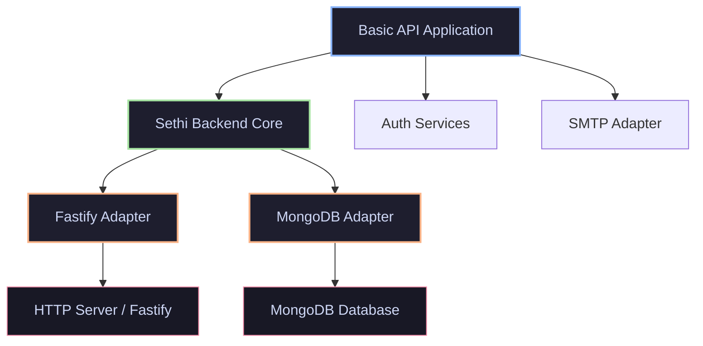
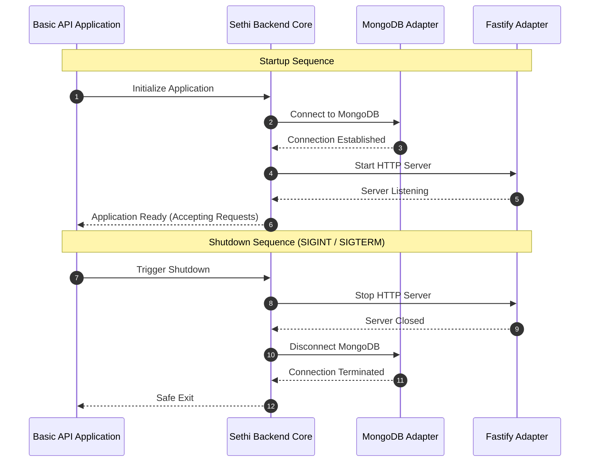

<div align="center">

# Sethi Backend

  <p><strong>An evolving modular TypeScript backend framework built with independent infrastructure adapters.</strong></p>
  <p>Separating the application lifecycle from HTTP servers and database implementations.</p>

  <p>
    <a href="https://github.com/usman-sethi/sethi_backend"></a>
    <a href="https://github.com/usman-sethi/sethi_backend"></a>
    <a href="https://github.com/usman-sethi/sethi_backend"></a>
    <a href="https://github.com/usman-sethi/sethi_backend"></a>
    <a href="https://github.com/usman-sethi/sethi_backend"></a>
    <a href="https://github.com/usman-sethi/sethi_backend"></a>
  </p>

  <p>
    <a href="#-about-sethi-backend">About</a> &bull;
    <a href="#-current-development-status">Status</a> &bull;
    <a href="#-architecture">Architecture</a> &bull;
    <a href="#-getting-started">Getting Started</a> &bull;
    <a href="#-api-endpoints">API Endpoints</a> &bull;
    <a href="#-testing">Testing</a> &bull;
    <a href="docs/deployment.md">Deployment</a> &bull;
    <a href="docs/security.md">Security</a> &bull;
    <a href="docs/authentication.md">Authentication</a> &bull;
    <a href="docs/packages.md">Packages</a> &bull;
    <a href="#-roadmap">Roadmap</a>
  </p>

</div>

---

## About Sethi Backend

**Sethi Backend** is a modular TypeScript backend framework engineered to provide a clean, decoupled foundation for building backend applications. By strictly separating the application lifecycle from infrastructure concerns—such as HTTP server frameworks and database drivers—Sethi Backend prevents tight coupling and ensures high testability, maintainability, and architectural longevity.

### Why Sethi Backend?
* **Decoupled Architecture:** Business logic and lifecycle management are completely independent of specific web frameworks (like Fastify) or persistence layers (like MongoDB).
* **Adapter Pattern:** Infrastructure is plugged in through rigorous TypeScript contracts (`@sethi-backend/*`), allowing components to be swapped or mocked effortlessly.
* **Monorepo Agility:** Built with `pnpm workspaces`, enabling clean separation of concerns across core modules, adapters, and example applications.
* **Robust Lifecycle Management:** Unified startup, liveness, readiness, and graceful shutdown sequencing out of the box.

---

## Current Development Status

Sethi Backend is currently in active development. The foundational milestone is complete, featuring a fully integrated basic API example.

| Category | Status | Capabilities |
| :--- | :--- | :--- |
| **Monorepo & Core** | ✅ Implemented | pnpm workspace setup, core engine lifecycle, HTTP/database adapter contracts, automated tests. |
| **HTTP Layer** | ✅ Implemented | Fastify server adapter, request/response lifecycle integration. |
| **Database Layer** | ✅ Implemented | MongoDB adapter, connection management, readiness probes (`/ready`). |
| **Observability** | ✅ Implemented | Server-generated request IDs, duration/error logs with redaction, `/health` liveness, `/ready` database check, structured graceful shutdown. |
| **Security & Auth** | ✅ Implemented | Argon2id, session-bound JWTs, refresh replay protection, email verification, password reset with transactional session revocation, SMTP delivery, persistent RBAC and audited role changes. |
| **Release validation** | 🚧 In progress | Required-service integration tests, isolated local package registry, independent consumer workflow, and CI validation are configured; MongoDB and installed-consumer verification must still execute in CI or locally. |

---

## Technology Stack

The framework leverages modern, high-performance tooling built for type safety and developer velocity:

* **Language:** TypeScript 7
* **Package Manager:** pnpm 12 workspaces
* **HTTP Framework:** Fastify 5
* **Database Driver:** MongoDB Node.js Driver 7
* **Testing Framework:** Vitest
* **Runtime:** Node.js 22.12+, 24.x, or 26+

---

## Architecture

Sethi Backend organizes code into decoupled workspace packages under `packages/` and functional examples under `examples/`.

```text
sethi_backend/
│
├── packages/
│   ├── core/                  # Application lifecycle and adapter contracts
│   ├── adapter-fastify/       # Fastify HTTP server implementation
│   ├── database-mongodb/      # MongoDB connection and repositories
│   ├── auth/                  # Authentication services and RBAC
│   ├── email/                 # SMTP email sender adapter
│   ├── security/              # Password hashing and token primitives
│   └── config/                # Typed environment validation
│
├── examples/
│   └── basic-api/             # Integrated sample application
│
├── .env.example
├── pnpm-workspace.yaml
├── tsconfig.base.json
└── package.json
```

### Package Responsibilities
* **`@sethi-backend/core`**: Defines abstract contracts for servers and databases, managing the overarching application startup and shutdown lifecycle.
* **`@sethi-backend/adapter-fastify`**: Implements the server contract using Fastify, translating HTTP requests and routing lifecycle hooks.
* **`@sethi-backend/database-mongodb`**: Implements the database contract, handling MongoDB connections, client pooling, and health pinging.
* **`@sethi-backend/auth`**: Defines authentication, account-action token, and authorization contracts and services.
* **`@sethi-backend/email`**: Implements SMTP delivery through Nodemailer; delivery is injected into authentication services.
* **`@sethi-backend/example-basic-api`**: Demonstrates how to wire core services, Fastify, and MongoDB together into a runnable backend application.

### Dependency Flow Diagram



---

## Lifecycle Sequence

The startup and graceful shutdown sequences guarantee predictable initialization and resource release across infrastructure components.



---

## Getting Started

### Prerequisites
* **Node.js**: `^22.12.0`, `^24.0.0`, or `>=26.0.0` (MongoDB driver support range)
* **pnpm**: `12.18.0` (repository package manager)
* **MongoDB**: Local installation running on `mongodb://127.0.0.1:27017` or a reachable MongoDB Atlas instance.

### 1. Clone the Repository
```bash
git clone https://github.com/usman-sethi/sethi_backend.git
cd sethi_backend
```

### 2. Install Dependencies
```bash
pnpm install
```

### 3. Configure Environment Variables
Copy the example environment configuration file:

* **PowerShell (Windows):**
  ```powershell
  Copy-Item .env.example .env
  ```
* **Bash (Linux/macOS):**
  ```bash
  cp .env.example .env
  ```

The example file is suitable for local development. Replace the placeholder
JWT secret before using the API:
```env
HOST=127.0.0.1
PORT=3000
MONGODB_URI=mongodb://127.0.0.1:27017
MONGODB_DATABASE=sethi_backend_dev
JWT_SECRET=<unique random secret of at least 32 bytes>
```

Generate a secret rather than using the placeholder:

* **PowerShell:** `[Convert]::ToBase64String([Security.Cryptography.RandomNumberGenerator]::GetBytes(48))`
* **OpenSSL:** `openssl rand -base64 48`

> **Note:** Ensure your MongoDB instance is active and reachable before starting the application. Never use the example placeholder in production or commit real database credentials or production secrets.

Build and start the example:

```bash
pnpm build
pnpm --filter @sethi-backend/example-basic-api start
```

Email-dependent authentication flows require an SMTP server. See the [environment
reference](#environment-variables) and [authentication guide](docs/authentication.md).

### Environment variables

| Variable | Development default | Production |
| :--- | :--- | :--- |
| `NODE_ENV` | `development` | Set to `production` to enable strict checks and secure cookies. |
| `HOST` | `127.0.0.1` | Bind deliberately; use a trusted TLS-terminating proxy when needed. |
| `PORT` | `3000` | Optional override. |
| `MONGODB_URI` | Required | Required; keep credentials in a secret manager. |
| `MONGODB_DATABASE` | `sethi_backend_dev` | Required explicitly; the development database name is rejected. |
| `JWT_SECRET` | Required | At least 32 characters and not an obvious placeholder; generate a random secret. |
| `JWT_ISSUER` / `JWT_AUDIENCE` | `sethi-backend` / `sethi-backend-api` | Override when isolating deployments or token consumers. |
| `ACCESS_TOKEN_TTL_SECONDS` | `900` | `60`–`3600`. |
| `CORS_ORIGINS` | `http://localhost:5173` | Required explicit HTTPS origin allowlist; wildcard and `null` are rejected. |
| `SMTP_HOST` / `SMTP_PORT` | blank / `587` | Required for the production account-verification and reset flows. |
| `SMTP_SECURE` | `false` | Use implicit TLS when `true`; otherwise production requires STARTTLS. |
| `SMTP_USER` / `SMTP_PASSWORD` | blank | Optional, but must be configured as a pair. |
| `EMAIL_FROM` / `APP_BASE_URL` | blank | Required for production email flows; base URL must use HTTPS. |
| `EMAIL_VERIFICATION_TOKEN_TTL_SECONDS` | `86400` | `60`–`604800`. |
| `PASSWORD_RESET_TOKEN_TTL_SECONDS` | `1800` | `60`–`604800`. |

See [.env.example](.env.example) for the complete variable template and
[deployment guide](docs/deployment.md) for production setup.

---

## Building the Project

Compile all workspace packages in dependency order (including declarations):
```bash
pnpm build
```

To build individual workspace packages separately:
```bash
pnpm --filter @sethi-backend/core build
pnpm --filter @sethi-backend/adapter-fastify build
pnpm --filter @sethi-backend/database-mongodb build
pnpm --filter @sethi-backend/example-basic-api build
```

---

## Running the Example Application

Start the integrated basic API example in development mode:
```bash
pnpm --filter @sethi-backend/example-basic-api start
```

The server will initialize at:
`http://127.0.0.1:3000`

The development environment intentionally permits the sample JWT secret and
does not require SMTP. Production startup rejects placeholder secrets, missing
origins/database identity, and incomplete email configuration.

---

## API Endpoints

The basic API example exposes health, readiness, CSRF-token, and authentication
endpoints:

| Method | Endpoint | Purpose |
| :--- | :--- | :--- |
| `GET` | `/health` | Application liveness check |
| `GET` | `/ready` | MongoDB database readiness check |
| `GET` | `/csrf-token` | Creates a CSRF token for a cookie-authenticated client |
| `POST` | `/auth/register` | Register an unverified user and request an email verification link |
| `POST` | `/auth/login` | Authenticate and create a separate device session |
| `POST` | `/auth/refresh` | Rotate the refresh token and issue a new access token |
| `POST` | `/auth/verify-email` | Consume a one-time email verification token |
| `POST` | `/auth/resend-verification` | Request another verification email without account disclosure |
| `POST` | `/auth/forgot-password` | Request a password-reset email with a generic response |
| `POST` | `/auth/reset-password` | Reset a password and atomically revoke all sessions |
| `POST` | `/auth/logout` | Revoke the current refresh-token session |
| `POST` | `/auth/logout-all` | Revoke every active session for the authenticated user |
| `GET` | `/auth/me` | Return the authenticated user's public profile |
| `GET` | `/admin/dashboard` | Admin-only dashboard |
| `GET` | `/admin/users` | List public user records (`users:read`) |
| `PATCH` | `/admin/users/:userId/role` | Change another verified user's role (`roles:manage`) |

Cookie-authenticated POST requests (`register`, `login`, `refresh`, `logout`,
and `logout-all`) require a CSRF token. Fetch `GET /csrf-token`, retain its
cookie, and send the returned value in `X-CSRF-Token`. Registration returns
HTTP 202 with a generic message and does not create a session. The user must
verify the address before login. Login returns an access token and public user;
refresh tokens are sent only as HttpOnly, SameSite=Lax cookies scoped to
`/auth`. Access tokens are bound to persistent sessions, and a revoked or
expired session invalidates them. The default session lifetime is 30 days;
MongoDB TTL cleanup is asynchronous.

Each successful refresh atomically swaps the current token hash and appends the
consumed hash to its session document. Reuse of any consumed token is treated as
replay and revokes that session; this strict policy also applies to simultaneous
refresh attempts, so one attempt may receive a response whose access token is
immediately invalidated by the competing replay. Consumed hashes remain only
until the session expires and MongoDB TTL cleanup removes its document.
Sessions are revoked at 100,000 rotations rather than allowing their retained
history to grow without bound; the user must authenticate again. Rotation uses
single-document atomic updates and does not require MongoDB transactions or a
replica set. Session documents have a unique current-token index, a consumed
hash lookup index, an expiry TTL index, and a user/revocation index.
On the first startup after this replay-history change, legacy active sessions
without consumed-token history are revoked; affected users must sign in again.

Refresh, logout and logout-all security events are logged with event type and
safe user/session identifiers only. The refresh route is limited to 10
requests per minute per rate-limit key.

Use the access token as a bearer token for `/auth/me` and `/auth/logout-all`.
The logout-all endpoint also requires a CSRF token because browser clients may
send the refresh cookie.

### Response Examples

* **`/health` (Liveness)**
  ```json
  {
    "status": "ok",
    "service": "sethi-backend",
    "uptimeSeconds": 12
  }
  ```

* **`/ready` (Readiness)**
  ```json
  {
    "status": "ready",
    "database": "reachable"
  }
  ```
  > *Note: `/ready` returns HTTP status `503 Service Unavailable` if the MongoDB database connection is dropped or unreachable.*

### Email verification and password reset

Configure outbound SMTP and the frontend URL before using email-dependent
features. The SMTP adapter sends both HTML and plain-text messages. Verification
and reset links place the random token in the URL fragment (for example,
`https://app.example/verify-email#token=...`) so it is not sent in ordinary
HTTP requests or access logs. The frontend reads the fragment and POSTs the
token in JSON; the API never consumes tokens from a GET request.

```http
POST /auth/register
Content-Type: application/json

{"email":"user@example.com","password":"a long unique passphrase"}
```

```json
{"message":"If registration can be completed, verification instructions will be sent."}
```

Submit the verification token:

```http
POST /auth/verify-email
Content-Type: application/json

{"token":"<token read from the URL fragment>"}
```

A successful verification returns `204 No Content`; invalid, expired, or
consumed tokens return `400`. `POST /auth/resend-verification` accepts
`{"email":"user@example.com"}` and always returns the same generic HTTP 202
response whether the account exists, is verified, or delivery fails.

Password reset uses a generic response for known and unknown addresses:

```http
POST /auth/forgot-password
Content-Type: application/json

{"email":"user@example.com"}
```

```json
{"message":"If an account exists for this email, password reset instructions will be sent."}
```

The frontend submits the fragment token and the new password to
`POST /auth/reset-password`:

```json
{"token":"<token read from the URL fragment>","newPassword":"a different long unique passphrase"}
```

Reset tokens expire after 30 minutes by default. Verification tokens expire
after 24 hours. Both durations are configurable. Only hashes are persisted;
tokens are replaced on resend, have explicit expiration checks, and are
consumed once. Password reset hashes the new password before opening a MongoDB
transaction, then atomically consumes the token, changes the password, and
revokes every active session. MongoDB must run as a replica set (including a
single-node replica set) for these transactional operations. If a transaction
cannot run, the password and token remain unchanged.

Email send failures do not reverse registration or password changes. A user can
request another email; issuing a new link replaces the prior token. Delivery
failures are logged with a safe event type and user ID only. This implementation
sends through SMTP directly and does not provide a durable outbox; after a
process crash, users can safely request a resend/reset again.

#### Email environment

New optional variables in `.env.example`:

| Variable | Default / example | Use |
| :--- | :--- | :--- |
| `SMTP_HOST` | empty | SMTP server hostname |
| `SMTP_PORT` | `587` | SMTP server port |
| `SMTP_SECURE` | `false` | Use implicit TLS (typically port 465) |
| `SMTP_USER` | empty | Optional SMTP username |
| `SMTP_PASSWORD` | empty | Optional SMTP password; never commit a real value |
| `EMAIL_FROM` | empty | Sender address, required when SMTP is configured |
| `APP_BASE_URL` | empty | Frontend origin, required with SMTP; HTTPS is required in production |
| `EMAIL_VERIFICATION_TOKEN_TTL_SECONDS` | `86400` | Verification token lifetime |
| `PASSWORD_RESET_TOKEN_TTL_SECONDS` | `1800` | Password-reset token lifetime |

Set `SMTP_HOST`, `EMAIL_FROM`, and `APP_BASE_URL` together. SMTP user/password
must also be paired. SMTP may be left blank for development and tests, but
email delivery will be unavailable until it is configured. The app does not
log SMTP credentials, message links, or tokens.

### Roles and permissions

The role stored in MongoDB is authoritative for each protected request; JWTs
contain identity/session claims only. The guard checks the current user and
session, and permission hooks resolve the current role on every request.
Privilege changes therefore apply to the next request without waiting for an
access token to expire.

| Role | Permissions |
| :--- | :--- |
| `user` | `profile:read`, `profile:update` |
| `moderator` | User permissions plus `users:read`, `users:manage`, `sessions:revoke` |
| `admin` | All defined permissions, including `roles:manage` |

Admin dashboard access and role changes require `roles:manage`; user listing
requires `users:read`. A role change cannot target the acting administrator,
cannot promote an unverified account, and cannot demote the final admin.
Successful role changes are written to `auth_audit_logs` in the same MongoDB
transaction as the role update.

Provision the first admin only after registering and verifying the operator's
account. Build the example first, then run this local interactive command from
the repository root:

```powershell
pnpm --filter @sethi-backend/example-basic-api build
pnpm --filter @sethi-backend/example-basic-api admin:promote -- --email admin@example.com
```

It reads the configured MongoDB connection, verifies that the account exists
and has a verified email, requires exact email confirmation in an interactive
terminal, and records the promotion in the audit collection. There is no
unauthenticated admin-promotion HTTP route.

### MongoDB migration and indexes

At startup, `auth_users` documents missing verification state are treated as
unverified and missing roles are assigned the least-privileged `user` role.
These migrations do not grant privileges. Active legacy sessions without
refresh replay history are revoked as documented above.

The application creates `auth_action_tokens` with unique token-hash and
user/purpose indexes plus an expiry TTL index. It creates role lookup and
auditing indexes and a lock record used to serialize administrator-role
changes. TTL indexes are cleanup only; token and session expiration are checked
explicitly. Ensure the MongoDB deployment supports transactions before
enabling email verification/password reset or role changes.

## Fastify HTTP security

The Fastify adapter exposes `registerHttpSecurity`. Register it before routes,
with an explicit origin allowlist and the application environment:

```ts
registerHttpSecurity(http.instance, {
  allowedOrigins: ["https://frontend.example"],
  environment: "production",
});
```

The adapter adds Helmet headers, credentialed CORS for only the configured
origins, cookie parsing/serialization, CSRF-token helpers, and a rate-limit
plugin that is opt-in per route. CORS origins are normalized and reject
wildcards, `null`, invalid URLs, and non-HTTPS production origins. A disallowed
browser origin may still receive an HTTP response, but it does not receive
`Access-Control-Allow-Origin`.

CSRF verification is also opt-in per route, so public and bearer-token routes
are not forced to use CSRF tokens. Use `createCsrfProtectionHook` on routes
that rely on browser cookies, and obtain a token from `GET /csrf-token` before
sending the `X-CSRF-Token` header:

```ts
http.instance.post(
  "/account/update",
  {
    onRequest: createCsrfProtectionHook(http.instance),
    config: { rateLimit: { max: 10, timeWindow: "1 minute" } },
  },
  async () => ({ status: "updated" }),
);
```

CSRF cookies are HttpOnly, SameSite=Lax, and Secure in production. The default
rate-limit store is in-memory; multi-instance deployments need a shared store.
Configure Fastify's proxy trust only for known trusted reverse proxies before
relying on forwarded client addresses or HTTPS termination.

---

## Testing

Run the test suite across all workspace packages via Vitest:
```bash
pnpm test
```

### Test coverage
The Vitest suite covers core lifecycle behavior, HTTP security and CORS, config
validation, password/token utilities, SMTP transport behavior, account-action
flows, RBAC, session behavior, and mocked MongoDB repository operations.

The authentication repository tests use mocks; they do not claim a live
MongoDB integration test. The Fastify injection tests exercise the complete
HTTP lifecycle with repository doubles.

### Real integration tests and package consumer

The strict `pnpm test:integration` command requires local MongoDB replica-set,
Mailpit, and explicit test-only variables. It fails clearly when services are
missing and does not skip tests. Its nine tests verify real MongoDB persistence
and transactions, HTTP authentication/RBAC, and delivered SMTP messages.

Run `pnpm test:services:up` and `pnpm test:services:wait`, configure the test
variables, then run `pnpm test:integration`. `pnpm validate:packages` publishes
the seven built tarballs only to a loopback Verdaccio registry, installs them
outside the monorepo, type-checks a consumer, and exercises a real API against
the same isolated services. See the [integration and package-consumer guide](docs/integration-testing.md)
for exact commands and cleanup instructions.

---

## Graceful Shutdown

Sethi Backend listens for termination signals (`SIGINT` and `SIGTERM`). Upon receiving a signal (e.g., pressing `Ctrl + C`), the application executes a structured teardown:
1. Stops accepting new HTTP requests and closes the Fastify server.
2. Gracefully disconnects active MongoDB client pools.
3. Exits with status code `0` on success or non-zero if shutdown fails.

---

## Project Roadmap

- [x] **Milestone 1 — Foundation** *(Completed)*
  - Core lifecycle engine
  - Fastify HTTP adapter
  - MongoDB database adapter
  - Basic API reference application
- [x] **Milestone 2 — Configuration & Security** *(Completed)*
  - Zod-based environment validation
  - Argon2id password hashing primitives
  - JWT token architecture
  - CORS and secure cookie management
- [x] **Milestone 3 — Authentication Engine** *(Completed)*
  - User registration & login flows
  - Refresh token rotation
  - Session management & test suites
- [x] **Milestone 4 — Advanced Auth & RBAC** *(Completed)*
  - Email verification & password reset
  - Role-based access control (RBAC)
  - Security integration testing
- [ ] **Milestone 5 — Developer CLI** *(Planned)*
  - Project initialization CLI (`sethi init`)
  - Code generators & templates
  - System diagnostics
- [ ] **Milestone 6 — Release Preparation** *(In progress; not yet release-certified)*
  - Production configuration and dependency hardening
  - Package build and packing verification
  - Live MongoDB and SMTP execution remains environment-dependent

---

## Development

Developers can explore and modify workspace packages:
* **Run tests in watch mode:** `pnpm test:watch`
* **Adding an Adapter:** Create a new package under `packages/` implementing the respective core contract interface (`ServerAdapter` or `DatabaseAdapter`).

See the [package overview](docs/packages.md), [authentication guide](docs/authentication.md),
[security guide](docs/security.md), [deployment guide](docs/deployment.md), and
[troubleshooting guide](docs/troubleshooting.md) for package imports and
operational details.

---

## Contributing

Contributions, feature proposals, and bug reports are welcome. Please open an issue or submit a pull request on GitHub for discussion before introducing major architectural modifications.

---

## License

This project is licensed under the terms specified in the repository. Refer to the repository root for license details.
